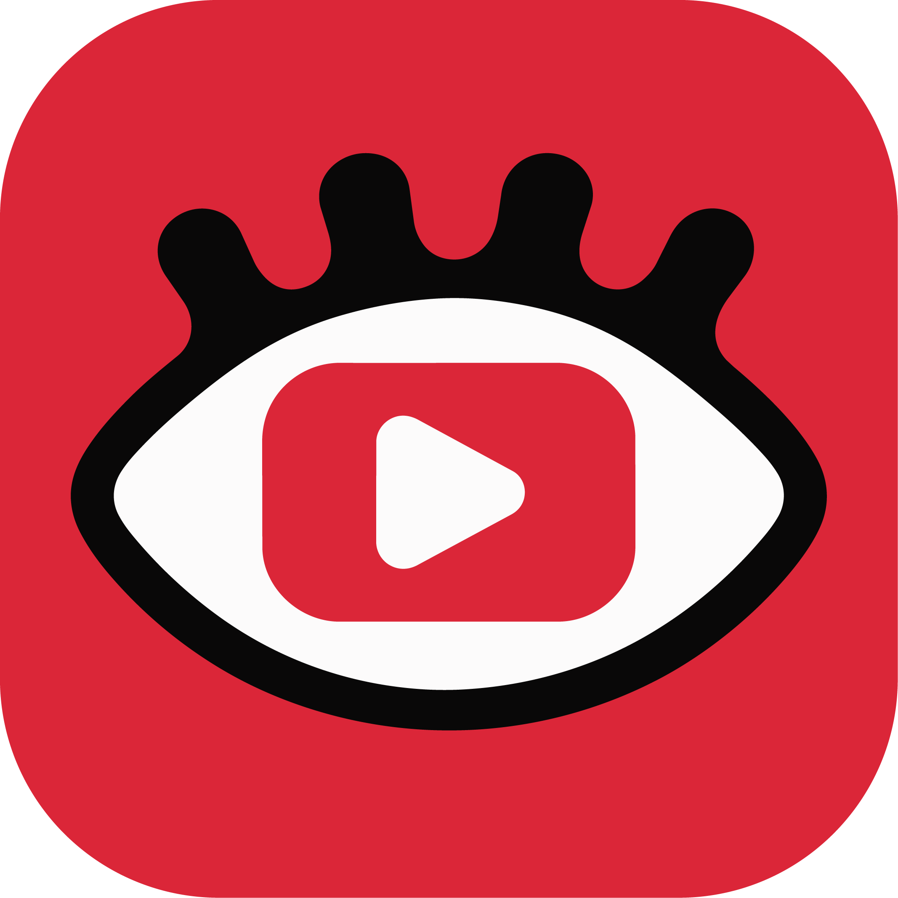
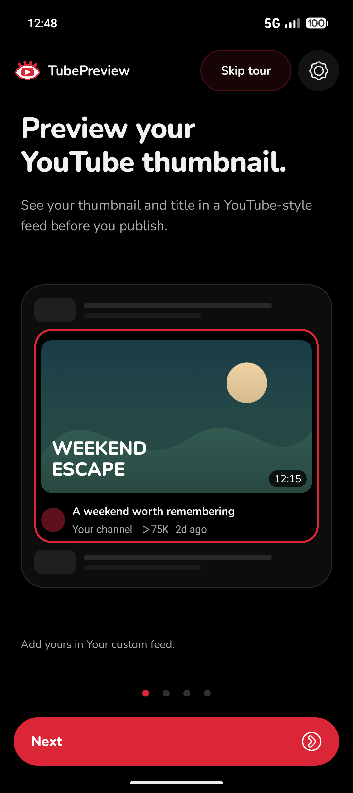
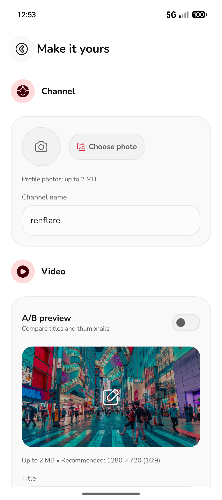
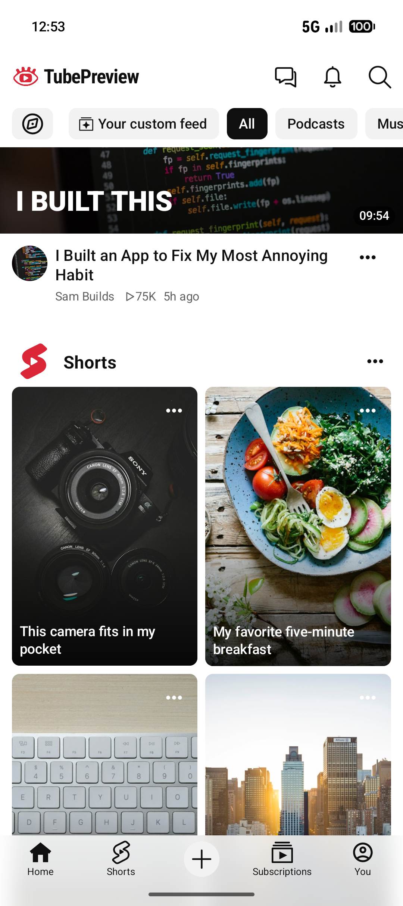

<p align="center">
  
</p>

<h1 align="center">TubePreview</h1>
<p align="center">Preview your YouTube thumbnails and titles before you publish.</p>

<p align="center">
  <a href="https://github.com/notrenflare/TubePreview/releases/latest"><strong>Download for Android</strong></a>
  · <a href="#features">Features</a>
  · <a href="#build-from-source">Build from source</a>
  · <a href="https://github.com/notrenflare/TubePreview/issues">Report a bug</a>
</p>

<p align="center">
  <a href="https://github.com/notrenflare/TubePreview/actions/workflows/ci.yml"></a>
  <a href="LICENSE"></a>
  
</p>

See how your next YouTube video looks in a familiar mobile feed. Add your thumbnail, title, and channel branding, then compare alternatives among sample videos. No account or YouTube sign-in required.

<table align="center">
  <tr>
    <td align="center"><strong>Dark feed</strong><br /><br /><a href="docs/screenshots/home-dark.png"></a></td>
    <td align="center"><strong>Light feed</strong><br /><br /><a href="docs/screenshots/home-light.png"></a></td>
  </tr>
  <tr>
    <td align="center"><strong>A/B preview</strong><br /><br /><a href="docs/screenshots/ab-preview.png"></a></td>
    <td align="center"><strong>Interactive tour</strong><br /><br /><a href="docs/screenshots/onboarding.png"></a></td>
  </tr>
  <tr>
    <td align="center"><strong>Your channel</strong><br /><br /><a href="docs/screenshots/customize.png"></a></td>
    <td align="center"><strong>Sample Shorts</strong><br /><br /><a href="docs/screenshots/shorts.png"></a></td>
  </tr>
</table>

## Features

- **Preview in a YouTube-style feed.** Check thumbnails, title wrapping, channel avatars, and video metadata at a realistic size.
- **Compare up to three options.** Try titles, thumbnails, or both. Pull to refresh to cycle through your choices.
- **Make it your channel.** Customize your name, crop your photo, and set video views and duration.
- **Change the surroundings.** Shuffle sample videos and Shorts, adjust feed size, and choose how often your preview appears.
- **Learn by trying.** An interactive tour walks through previews, comparisons, refresh, and channel setup.
- **Check light and dark mode.** Review your thumbnail in both themes.

A/B preview compares appearance; it does not run a YouTube experiment or predict click-through rates.

## Download

[**Download TubePreview for Android**](https://github.com/notrenflare/TubePreview/releases/latest/download/TubePreview-1.1.1.apk)

Requires Android 7.0 or newer. Download the APK and follow Android's installation prompts.

## Getting started

1. Set your channel name and optionally add a photo.
2. Open **Your custom feed** to choose a thumbnail and enter your title.
3. Return to the home feed to see your video among the samples.
4. Enable **A/B preview**, add your alternatives, and pull to refresh to compare.

Images can be up to 2 MB each. Use a 16:9 thumbnail; 1280 × 720 works well.

## Privacy

Your imported images and settings stay on your device. No analytics, ads, or account required. Sample feed photos load from Unsplash over HTTPS. Uninstalling or clearing app data removes saved previews.

See the [privacy policy](docs/PRIVACY.md) for details.

## Build from source

Use Android Studio, JDK 21, and Android SDK Platform 37.

```sh
git clone https://github.com/notrenflare/TubePreview.git
cd TubePreview
bash ./gradlew :app:assembleDebug
```

Run the `app` configuration on a device or emulator. No API keys or backend setup are needed.

```sh
bash ./gradlew :app:testDebugUnitTest :app:lintDebug
```

Built with Kotlin, Jetpack Compose, DataStore, coroutines, and Coil. See the [architecture guide](docs/ARCHITECTURE.md) and [distribution guide](docs/DISTRIBUTION.md).

## Contributing

Bug reports and focused improvements are welcome. Read [CONTRIBUTING.md](CONTRIBUTING.md) for setup and checks, or the [security policy](SECURITY.md) to report a vulnerability.

## License

[Apache License 2.0](LICENSE). Third-party assets retain their own licenses; see [THIRD_PARTY_NOTICES.md](THIRD_PARTY_NOTICES.md). The license does not grant trademark rights to the TubePreview name or logo.

TubePreview is independent and is not affiliated with YouTube or Google. YouTube and YouTube Shorts are trademarks of Google LLC.

Made with ❤️ by [renflare](https://github.com/notrenflare), with contributions from [Codex](https://github.com/codex).
