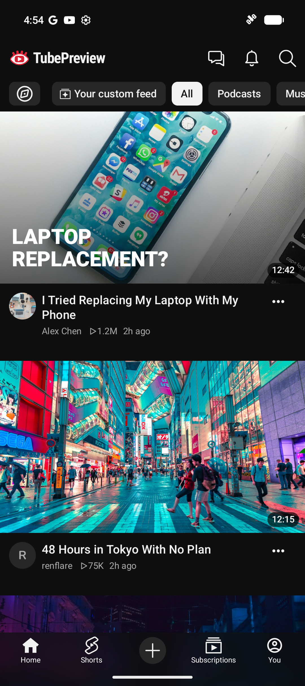
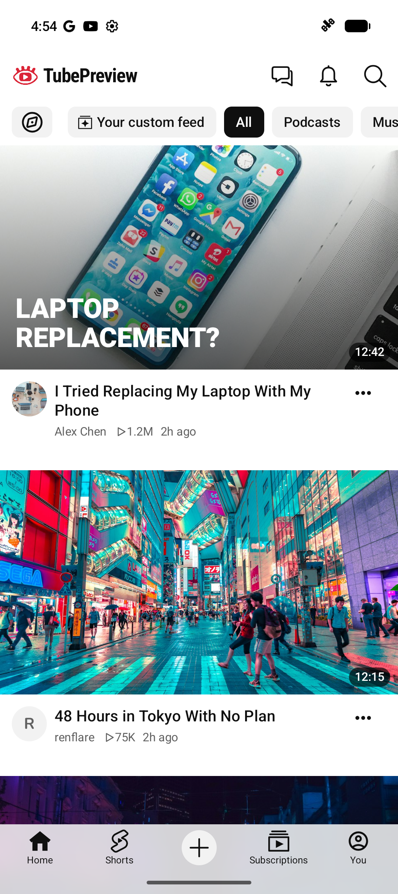
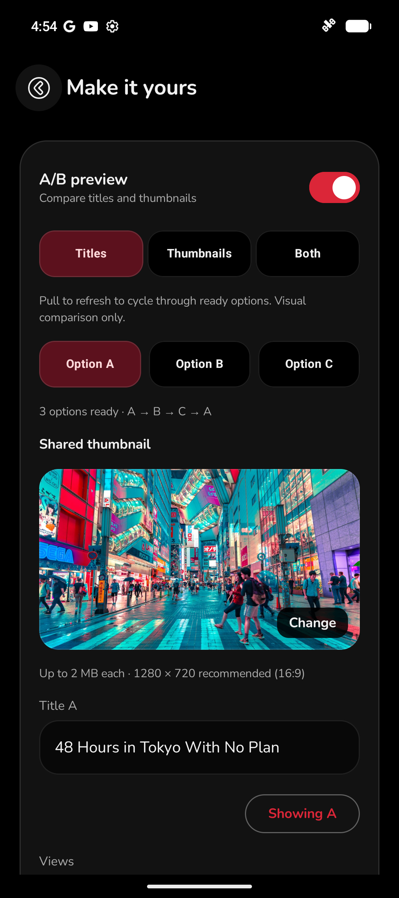

<p align="center">
  
</p>

<h1 align="center">TubePreview</h1>
<p align="center">See your thumbnail in the feed before you publish.</p>

<p align="center">
  <a href="https://github.com/notrenflare/TubePreview-releases/releases/latest"><strong>Download for Android</strong></a>
  · <a href="#features">Features</a>
  · <a href="#build-from-source">Build from source</a>
  · <a href="https://github.com/notrenflare/TubePreview/issues">Report a bug</a>
</p>

<p align="center">
  <a href="https://github.com/notrenflare/TubePreview/actions/workflows/ci.yml"></a>
  
</p>

TubePreview is a native Android app for trying thumbnails, titles, and channel branding in a YouTube-style home feed. Place your preview among sample videos, scroll past it, and see how it reads at a realistic size. No account or YouTube sign-in required.

<p align="center">
  <a href="docs/screenshots/home-dark.png"></a>
  <a href="docs/screenshots/home-light.png"></a>
  <a href="docs/screenshots/ab-preview.png"></a>
</p>

## Features

- **Preview in context.** Full-width thumbnails, channel avatars, titles, and compact video metadata in a familiar mobile feed.
- **Compare up to three options.** Try titles, thumbnails, or paired combinations. Pull to refresh to cycle through ready options, or select one directly.
- **Make it yours.** Set your channel name, crop and reposition your avatar, and customize views and duration.
- **Refresh the surroundings.** Shuffle sample videos and Shorts, adjust feed size, and control how often your preview appears.
- **Check both themes.** Light and dark mode, with translucent navigation and scrolling status-bar protection.

A/B preview is a visual comparison tool. It does not run a YouTube experiment, collect viewer responses, or predict click-through rates.

## Download

[**Get the latest signed APK**](https://github.com/notrenflare/TubePreview-releases/releases/latest) for Android 7.0 (API 24) or newer.

Open the APK on your phone and follow Android's installation prompts. Each release includes a SHA-256 checksum and the signing certificate fingerprint. Install updates over the existing app to keep your saved previews.

## Getting started

1. Set your channel name and optionally choose a channel photo.
2. Open **Your custom feed** and select a thumbnail, then enter your title and metadata.
3. Return to the feed to review your card among sample videos.
4. Enable **A/B preview** to add options B and C. Choose **Titles**, **Thumbnails**, or **Both**, then refresh the feed to compare.

Images can be up to 2 MB each. A 1280 × 720 thumbnail works well for the 16:9 preview.

## Privacy

Your imported images and settings stay in private storage on your device. TubePreview has no analytics, ads, backend, or upload service. Sample feed photos load from Unsplash over HTTPS, so that provider receives ordinary network request metadata.

App data is excluded from Android backup and device transfer. Clearing app data or uninstalling removes your saved previews. See the [privacy policy](docs/PRIVACY.md) for details.

## Build from source

Use Android Studio, JDK 21, and Android SDK Platform 37. The Gradle wrapper supplies the Gradle version.

```sh
git clone https://github.com/notrenflare/TubePreview.git
cd TubePreview
bash ./gradlew :app:assembleDebug
```

Run the `app` configuration on a device or emulator. No API keys or backend setup are needed.

```sh
bash ./gradlew :app:testDebugUnitTest :app:lintDebug
```

Built with Kotlin, Jetpack Compose, Preferences DataStore, coroutines, and Coil. The [architecture guide](docs/ARCHITECTURE.md) describes the main modules.

## Contributing

Bug reports and focused improvements are welcome. Read [CONTRIBUTING.md](CONTRIBUTING.md) for setup and checks. Report vulnerabilities through the [security policy](SECURITY.md).

TubePreview is an independent project and is not affiliated with YouTube or Google. YouTube and YouTube Shorts are trademarks of Google LLC. Third-party asset credits are listed in [THIRD_PARTY_NOTICES.md](THIRD_PARTY_NOTICES.md).

Made with ❤️ by [renflare](https://github.com/notrenflare).
